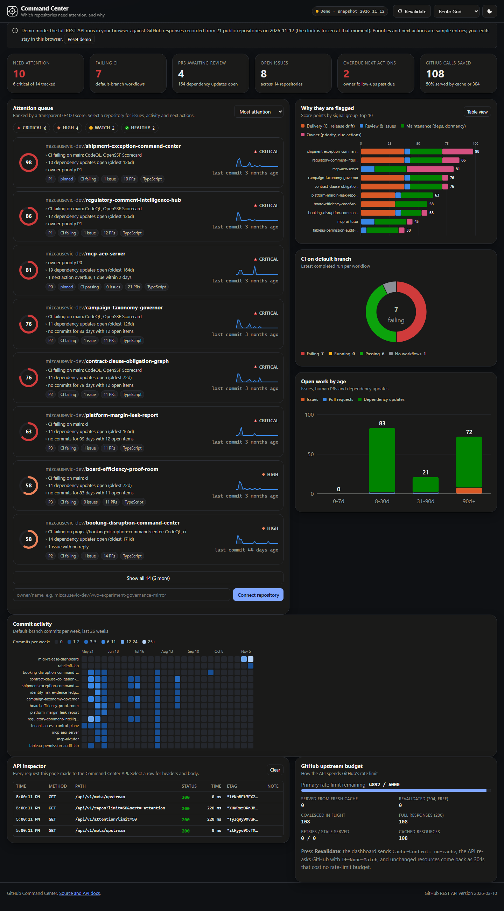
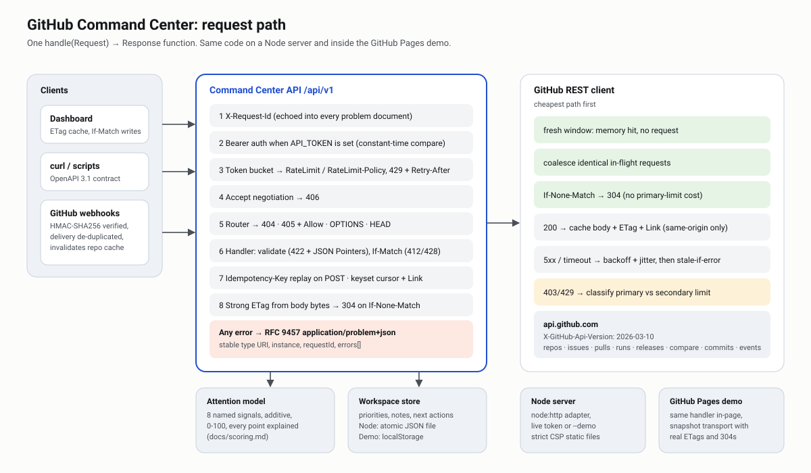
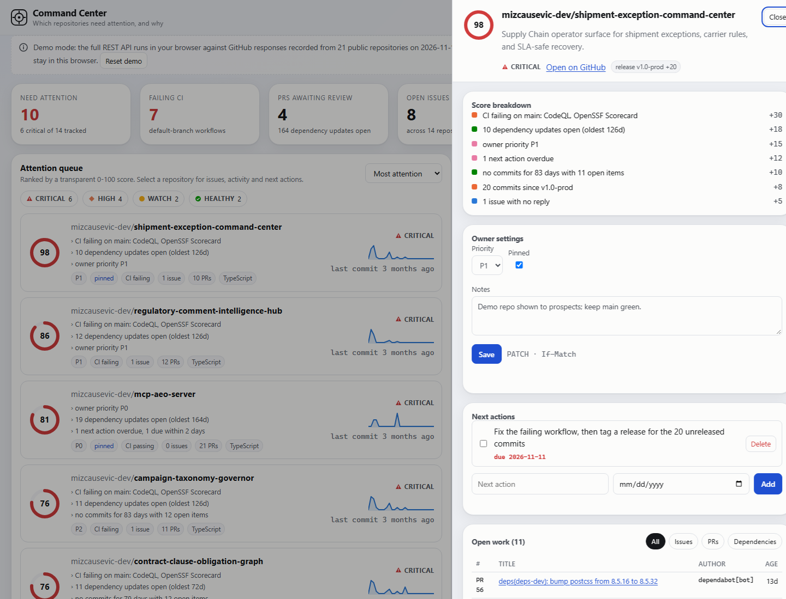
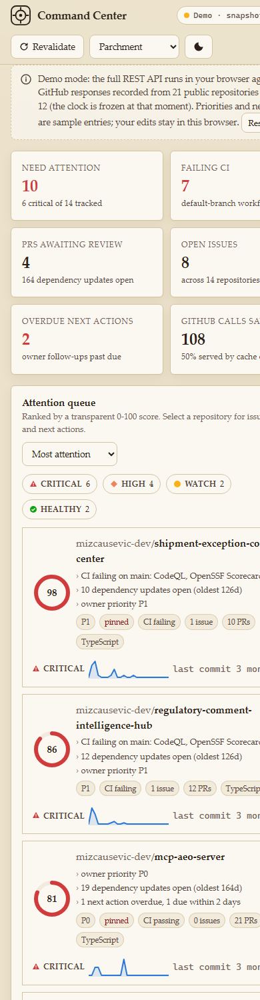

# GitHub Command Center

**Which repositories need you, and why.** A REST API and dashboard that pull open issues, pull requests, CI runs, releases and activity from GitHub. They rank your repositories by a transparent 0-100 attention score, and you add your own priorities and dated next actions on top.

**[Live demo](https://mizcausevic-dev.github.io/github-command-center/)** · [OpenAPI 3.1](src/api/openapi.ts) · [Error catalog](docs/errors.md) · [Scoring model](docs/scoring.md)



The demo shows real GitHub data: responses recorded on 2026-11-12 from 21 of the author's public repositories through the same client the server uses. The full API runs inside the page, so the API inspector at the bottom shows real ETags, 304s, `Link` headers and problem documents. Priorities and next actions in the demo are sample entries.

## What it shows about REST

| Concern | How it is handled | Where |
|---|---|---|
| Caching reads | Strong `ETag` from the response bytes. `If-None-Match` → `304` with no body. `Cache-Control: private, no-cache` | [`src/http/respond.ts`](src/http/respond.ts) |
| Lost updates | `PATCH` requires `If-Match` (`428` without it, `412` on mismatch, with the current `ETag` returned) | [`routes-repos.ts`](src/api/routes-repos.ts) |
| Partial updates | JSON Merge Patch (`application/merge-patch+json`). `null` clears a field | same |
| Retries without duplicates | `Idempotency-Key` on POST replays the first response (`Idempotent-Replayed: true`). Same key with a different body → `422`. Still in flight → `409` | [`src/http/idempotency.ts`](src/http/idempotency.ts) |
| Pagination | Keyset cursors (stable under inserts), RFC 8288 `Link` with `first`/`next`. A cursor is bound to its query, so reusing it with another sort → `400` | [`src/http/pagination.ts`](src/http/pagination.ts) |
| Errors | RFC 9457 `application/problem+json` with stable `type` URIs, `instance`, `requestId`, and one `errors[]` entry per bad field (JSON Pointer) | [`docs/errors.md`](docs/errors.md) |
| HTTP semantics | `404`, `405` + `Allow`, `OPTIONS`, `HEAD`, `406`, `415`, `413`. Unknown query parameters fail with `400` instead of being ignored | [`src/api/app.ts`](src/api/app.ts) |
| Rate limiting | Per-client token bucket with `RateLimit` / `RateLimit-Policy` headers and `429` + `Retry-After` | [`src/http/ratelimit.ts`](src/http/ratelimit.ts) |
| Contract | OpenAPI 3.1 served at `/api/v1/openapi.json`. A test fails if any route and the spec drift apart | [`test/contract.test.ts`](test/contract.test.ts) |
| Webhooks | HMAC-SHA256 over the raw body (WebCrypto `verify`), delivery de-duplication, cache invalidation per repository | [`routes-meta.ts`](src/api/routes-meta.ts) |

And as a consumer of the GitHub REST API ([`src/github/client.ts`](src/github/client.ts)):

- **Conditional requests.** Every cached resource is revalidated with `If-None-Match`. GitHub documents that an authorized `304` does not count against the primary rate limit. Measured against the live API on 2026-11-12: ten consecutive `304`s left `x-ratelimit-used` at 925, and the next `200` moved it to 926. The demo's replay transport applies the same rule, so **Revalidate** there shows hundreds of `304`s with the budget meter unchanged.
- **Request coalescing.** Identical concurrent requests share one upstream call.
- **Pagination.** Follows `rel="next"`. It refuses a `Link` URL on another origin, because following one would send the bearer token there.
- **Rate limits.** Primary (`x-ratelimit-remaining: 0` → wait until `x-ratelimit-reset`) and secondary (`retry-after`, else 60 s per GitHub's guidance) are classified separately and surfaced as `503` + `Retry-After`.
- **Resilience.** Retries 5xx and timeouts with exponential backoff and jitter, then serves the last good copy (stale-if-error). One broken repository renders as an inline error instead of failing the whole list.
- **Versioning.** Pins `X-GitHub-Api-Version: 2026-03-10`.



## Try it

```bash
npm ci
npm run build
npm run demo            # recorded snapshot, no token: http://127.0.0.1:8787
```

Against your own repositories (use a fine-grained, read-only token):

```bash
GITHUB_TOKEN=$(gh auth token) REPOS=owner/repo-a,owner/repo-b npm start
```

These responses were captured from the demo server:

```console
$ curl -si "localhost:8787/api/v1/repos?limit=2&sort=name" | grep -iE "^(etag|link|ratelimit)"
etag: "Vmv53TvOBpEGR6D7xy3BYHQ2aND"
link: </api/v1/repos?limit=2&sort=name>; rel="first", </api/v1/repos?limit=2&sort=name&cursor=eyJrIjpb…>; rel="next"
ratelimit: "default";r=90;t=15
ratelimit-policy: "default";q=120;w=60

$ curl -si -H 'If-None-Match: "Vmv53TvOBpEGR6D7xy3BYHQ2aND"' "localhost:8787/api/v1/repos?limit=2&sort=name" | head -1
HTTP/1.1 304 Not Modified

$ curl -s -X PATCH localhost:8787/api/v1/repos/mizcausevic-dev/mcp-ai-tutor/settings \
    -H 'Content-Type: application/merge-patch+json' -H 'If-Match: "isSnTd7-…"' -d '{"priority":"P3"}'
{"type":".../docs/errors.md#precondition-failed","title":"Settings changed","status":412,
 "detail":"The settings were modified since you read them; GET them again and reapply your change", ...}

$ curl -s -X POST localhost:8787/api/v1/repos -H 'Content-Type: application/json' \
    -d '{"fullName":"nope","priority":"P9","colour":"red"}'
{"type":".../docs/errors.md#validation","status":422,"detail":"3 field error(s)","errors":[
  {"pointer":"/colour","detail":"unknown field"},
  {"pointer":"/fullName","detail":"must look like owner/name"},
  {"pointer":"/priority","detail":"must be one of: P0, P1, P2, P3"}]}
```

## Endpoints

| Method | Path | Purpose |
|---|---|---|
| GET | `/api/v1/attention` | Portfolio summary, work-aging histogram, ranked queue |
| GET · POST | `/api/v1/repos` | List (sort, band, q, pinned, cursor) · connect a repository |
| GET · DELETE | `/api/v1/repos/{owner}/{repo}` | Detail with score breakdown · disconnect (cascades to its next actions) |
| GET · PATCH | `/api/v1/repos/{owner}/{repo}/settings` | Priority, notes, pinned (If-Match) |
| GET | `/api/v1/repos/{owner}/{repo}/issues` | Open issues, PRs, dependency updates (cursor) |
| GET | `/api/v1/repos/{owner}/{repo}/activity` | Events, weekly commits, recent CI runs (cursor) |
| GET · POST | `/api/v1/repos/{owner}/{repo}/next-actions` | List · create (Idempotency-Key) |
| GET | `/api/v1/next-actions` | Workspace-wide, soonest due first |
| GET · PATCH · DELETE | `/api/v1/next-actions/{id}` | Read · edit or complete (If-Match) · delete |
| GET | `/api/v1/meta/upstream` | GitHub rate budget, cache hit ratio, 304 count |
| GET | `/api/v1/meta/scoring` | Bands and weights |
| POST | `/api/v1/webhooks/github` | Signed webhook intake |
| GET | `/api/v1/openapi.json` | The contract |

## Dashboard



The dashboard is vanilla TypeScript with hand-built SVG charts and no UI or chart library. It has:

- A ranked attention queue with a sparkline for each repo.
- A score breakdown by signal group, with a table view.
- CI status on default branches.
- An open-work aging histogram.
- A 26-week commit heatmap.
- The API inspector and the GitHub budget panel.

Chart colors were checked for color-vision deficiency in light and dark modes. Status is never shown by color alone. It runs under a strict CSP (no inline script or style) and works at 390 px wide.

Seven themes, each with light and dark modes (persisted, or set by link: `?theme=swiss&mode=light`). Deep links open a repository directly: `#repo=owner/name`.


| Light (Swiss Architect) | Mobile (Parchment) |
|---|---|
|  |  |

## Project layout

```
src/http/      framework-free HTTP toolkit: router, conditional requests, pagination, idempotency, problems, rate limit
src/github/    REST client, Link parser, snapshot replay, allow-list sanitizers
src/domain/    repository insights (7 endpoints → 1 view), attention model, workspace store
src/api/       routes, representations, OpenAPI document, composition root (handle(Request) → Response)
src/server/    node:http adapter and entry point
web/           dashboard (TypeScript, SVG charts, 7 themes)
scripts/       snapshot recorder, web build, screenshot generator
test/          49 tests: node:test, no test framework dependency
```

Zero runtime dependencies. Dev dependencies: `typescript`, `esbuild`, `@types/node`. Node 22.18+ runs the TypeScript sources directly (type stripping).

```bash
npm run check      # typecheck + 49 tests + build
```

## Reuse in another vertical

The core is a ranked queue of entities scored by explainable signals, with owner overrides and conditional sync from an upstream REST API. Swap the GitHub client for another upstream and the same API shape serves other queues:

- Vendor risk: SOC 2 report expiry, open findings, contract renewal dates.
- Store operations: stockouts, late shipments, review backlog.
- Customer success: overdue tickets, usage drop, renewal date.

The HTTP toolkit in `src/http/` has no domain knowledge and can be lifted as-is.

## License

MIT. See [LICENSE](LICENSE). Security notes: [SECURITY.md](SECURITY.md).
